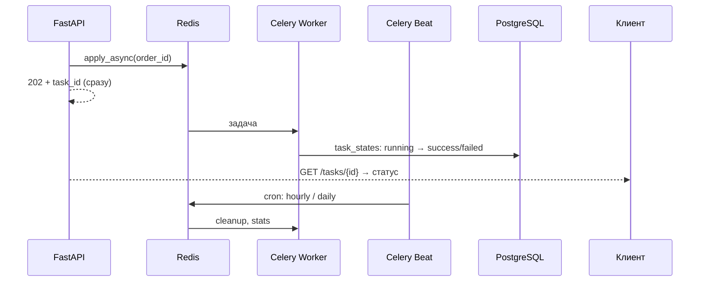

# OrderFlow Jobs

[Проверенный запуск и ограничения](VERIFICATION.md).

[](https://github.com/AlexGoster/orderflow-jobs/actions/workflows/ci.yml)


**Фоновые и периодические задачи для платформы OrderFlow**: письма, генерация счетов, отчёты и очистка — всё вынесено из HTTP-контура в Celery-очереди с Redis. Развитие [orderflow-core](https://github.com/AlexGoster/orderflow-core): API осталось быстрым, а «долгая» работа ушла в воркеры.

## Как это работает



## Задачи

| Задача | Расписание | Retry | Что делает |
|---|---|---|---|
| `tasks.send_order_email` | по событию (создание заказа) | exponential backoff, 5 попыток | Имитация письма-подтверждения (лог + результат в БД) |
| `tasks.generate_invoice_pdf` | по запросу `POST /orders/{id}/invoice` | экспоненциальный backoff | Текстовый счёт в файл, `invoice_path` в заказе |
| `tasks.recompute_daily_stats` | `crontab(hour=0, minute=5)` | 5 попыток | Агрегация заказов за день, upsert в `daily_stats` |
| `tasks.cleanup_expired_orders` | `crontab(minute=0)` — hourly | 5 попыток | Отмена «протухших» pending-заказов (идемпотентно) |

## Надёжность

- **Идемпотентность** — повторный запуск cleanup/stats не портит данные (upsert и условие в WHERE)
- **Трекинг статусов** — декоратор `@track_task` пишет `running → success|failed`, попытки и текст ошибки в таблицу `task_states`, доступную через API
- **`acks_late` + `reject_on_worker_lost`** — задача не теряется при падении воркера
- **Ретраи** — `autoretry_for` по сетевым ошибкам, `retry_backoff` с джиттером, `max_retries=5`
- **Отделение контуров** — API отвечает `202 Accepted` и отдаёт `task_id` для polling, не дожидаясь выполнения

## API

| Метод | Путь | Описание |
|---|---|---|
| POST | `/api/v1/orders/{id}/invoice` | `202` + `task_id` + `status_url` |
| GET | `/api/v1/tasks/{task_ref}` | Статус задачи (по celery id или числовому id) |
| GET | `/api/v1/tasks` | Список задач |
| — | остальные маршруты core | auth, products, orders |

Плюс кэш каталога в Redis (cache-aside, инвалидация при изменении) — фундамент для [orderflow-scale](https://github.com/AlexGoster/orderflow-scale).

## Стек

FastAPI · SQLAlchemy 2.0 (async) · Celery 5 (worker + beat + flower) · Redis (broker, result backend, кэш) · PostgreSQL · PyJWT · pytest (eager mode) · fakeredis · GitHub Actions

## Запуск

```bash
docker compose up -d
# API:      http://localhost:8000/docs
# Flower:   http://localhost:5555
```

Состав стека: `db`, `redis`, `api`, `worker`, `beat`, `flower`.

Локальная разработка и тесты (без Redis и Postgres — Celery в eager mode, Redis через fakeredis):

```bash
pip install . && pip install -r requirements-dev.txt
pytest --cov=app
```

## Тесты

**31 тест**: auth, products (включая HIT/MISS и инвалидацию кэша), orders, выполнение Celery-задач в eager mode, трекинг статусов, beat-расписание, политика ретраев. CI гоняет `ruff → mypy (strict) → pytest --cov → docker build`.

## Метрики

| Метрика | До (всё в HTTP-контуре) | После |
|---|---|---|
| `POST /orders/{id}/invoice` | ~800 мс (синхронная генерация) | **< 50 мс** (202 + очередь) |
| Письмо о заказе | блокирует ответ | в фоне, не влияет на latency |
| Периодические сводки | вручную | автоматически, cron в beat |

## Как дальше до production

- Dead letter queue и алерты на `failed`-статусы (Sentry для задач)
- Kombu + RabbitMQ как broker при росте нагрузки, отдельные очереди по приоритетам
- Мониторинг длины очередей (Prometheus exporter) и autoscaling воркеров
- Таски-саги для распределённых транзакций

## Лицензия

[MIT](LICENSE)
